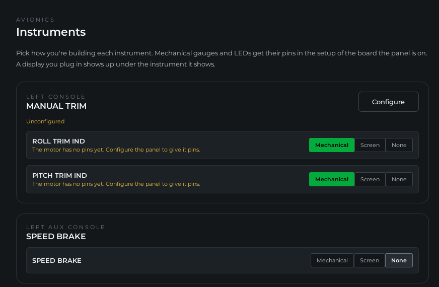
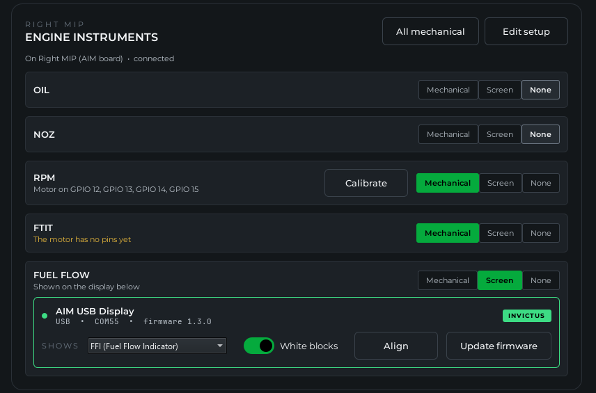
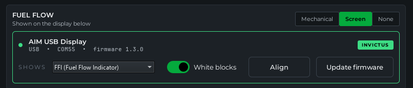
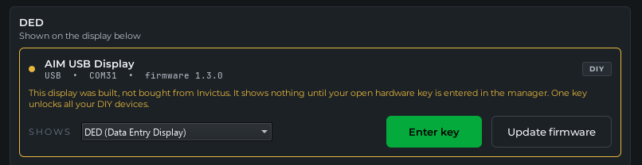
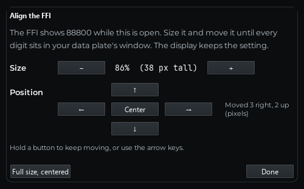
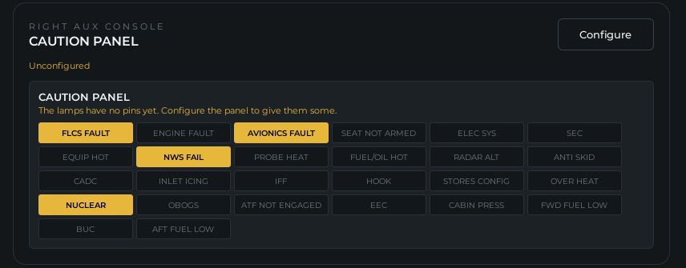

# Instruments

**What you'll do:** decide how each gauge and screen in your cockpit is built, set up the display boards you plug in, and check the caution panel.

> [!NOTE]
> Requires AIM Cockpit Manager **2.6.0** or later.

Open **Avionics**, then **Instruments**. The page lists every instrument of your airframe, panel by panel, with how each one is built and what drives it. It reads the same list as Console Panels, so the two pages always agree.

---

## Pick how each gauge is built

Each gauge has a row of choices:

| Choice | What it means |
|---|---|
| **Mechanical** | A real needle on a motor. The gauge gets its motor pins in the board's setup. |
| **Screen** | The gauge is on a screen: a display board, or a screen of your own. It needs no pins. |
| **LED** | Only on the oxygen FLOW blinker: one LED that lights whenever the sim shows FLOW. |
| **None** | You're not building it. It takes no pins. |

**All mechanical** at the top of a panel sets every gauge on it at once.

A gauge starts on **None**, except the trim gauges and O2 PRESSURE, which start on **Mechanical**.

The line under each gauge says what it still needs. "The motor has no pins yet" shows in orange until its pins are set, and then the line names the pins. Once a motor has pins, **Calibrate** shows on its row. See **Calibrate a gauge** on [Test and Calibrate](test-and-calibrate.md).

Each panel shows the board it's on and whether that board is connected. **Edit setup** opens that board's setup, where the motor pins are assigned. A panel no board has yet reads **Unconfigured**. **Configure** lists your boards, or adds a new one, and opens the board's setup with the panel already ticked.

---

## Displays

A DED, PFLD or FFI display board you plug in shows up under the instrument it shows. Its card says where it's plugged in, which firmware it runs, and whether it is **INVICTUS** hardware or a **DIY** build.

- **SHOWS** picks what the board shows: DED, PFLD or FFI. It changes right away and the board remembers it. Moving between a DED or PFLD and the FFI restarts the board on the other screen, and its card moves under that instrument.
- **White blocks** (FFI only) lights two blocks behind an engraved FUEL FLOW on your data plate.
- **Align** lines the screen up with your bezel or data plate. See **Align a screen** below.
- **Update to X.Y.Z** shows when the manager carries newer display firmware than the board runs. Click it. The display restarts into its loader, takes the new firmware and comes back by itself, with its settings kept. A strip at the top of the page shows the progress. When the board is up to date, **Update firmware** opens the Firmware page instead, for a firmware file of your own.

A display that shows something your airframe doesn't have is listed under **Other displays** at the end of the page.

A DED or PFLD on an AIM board's SPI channel names its board and channel on its row.

### Invictus and DIY displays

Displays from Invictus are signed at the factory and work as soon as they're plugged in. They never ask for a key, and their wiring is set at the factory.

A display you build yourself runs the same firmware. It shows nothing until your open hardware key is entered in the manager, and its card says so. One key unlocks all your DIY devices. Click **Enter key** on the card, or see [Open Hardware](open-hardware.md). A DIY display's wiring is set on the Open Hardware page.

### Align a screen

1. Click **Align** on the display's card.
2. The screen shows a test face: 888.0 on the FFI, and a full grid of 8s with the corner cells lit on the DED and PFLD.
3. Use **−** and **+** to make it smaller or bigger, and the arrows to move it. Hold a button to keep moving, or use the keyboard's arrow keys. **Center** puts it back in the middle, and **Full size, centered** undoes everything.
4. Click **Done**. The display keeps the setting.

| Screen | Size | Moves |
|---|---|---|
| FFI | 45 to 100 percent (its digits 20 to 44 pixels tall) | Up to 40 pixels left or right, 24 up or down |
| DED, PFLD | 70 to 100 percent | Up to 32 pixels left or right, 16 up or down |

Each kind of screen keeps its own setting, so a board moved between DED and PFLD keeps both. Align needs display firmware 1.3.0 or newer.

---

## Caution panel

The caution panel is set up here, not on Console Panels. Its card shows where its lamps are wired, and every cell lit as the sim lights it. **Test lamps** lights them all for three seconds. Wiring it is on [Indicator and Caution Lights](indicator-and-caution-lights.md).

---

## If something's wrong

| Problem | Fix |
|---|---|
| A gauge has no motor pins to assign in the board's setup | Set it to **Mechanical** first. A gauge on None or Screen takes no pins. |
| **Align** is missing on a display's card | The board runs display firmware older than 1.3.0. Click **Update to 1.3.0** on its card. |
| The update stops at "The display didn't reconnect" | This can happen once, on a display still on firmware 1.2.2 or older. Unplug it, hold its **BOOT** button while plugging it back in, then install **DED, PFLD or FFI display** from **Open Hardware**, **Install the firmware**. From 1.3.0 on, updates need no button. |
| A DIY display shows nothing | Enter your open hardware key. See [Open Hardware](open-hardware.md). |
| A display board isn't listed | Use a USB cable that carries data, and give it a few seconds after plugging in. |

---

**See also:** [Test and Calibrate](test-and-calibrate.md), [Indicator and Caution Lights](indicator-and-caution-lights.md), [Open Hardware](open-hardware.md), [Update Board Firmware](update-board-firmware.md)
