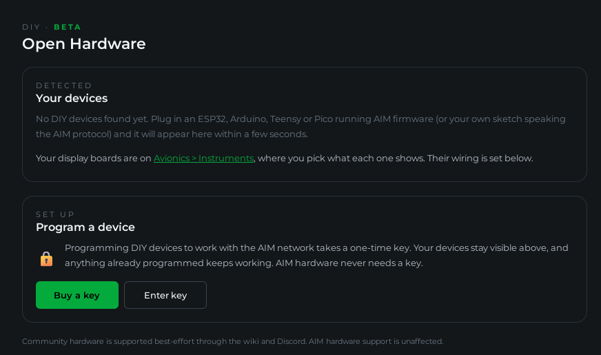
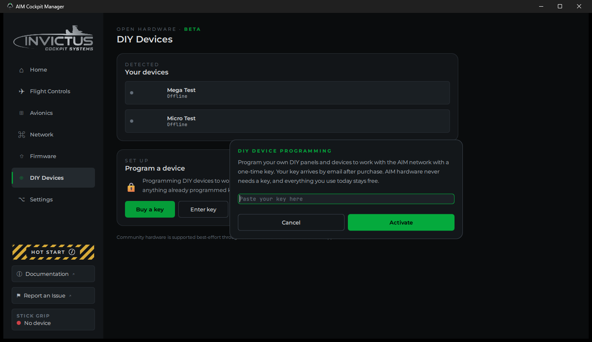
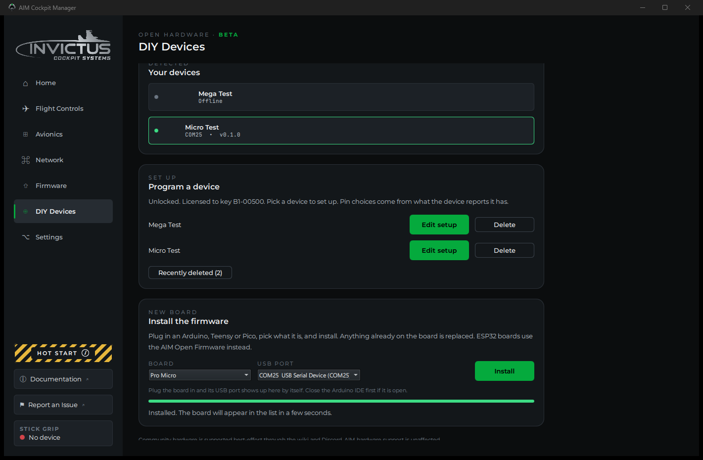
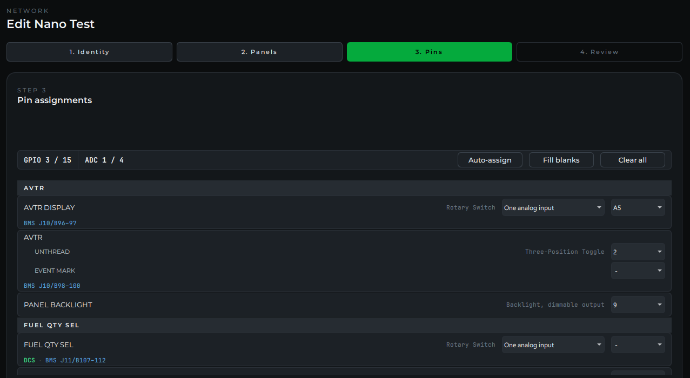
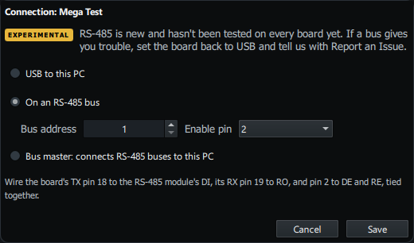

# Open Hardware

**What you'll do:** build a panel on your own Arduino, Teensy or Raspberry Pi Pico, install the manager's firmware on it over USB, and set it up the same way you set up an AIM board.

Open Hardware is for builders who already have a drawer of boards, or who want a small panel without a PoE switch. The boards plug into your PC over USB. Everything the manager does for an AIM board it does for these too: the setup wizard, live testing, learn mode, indicator lights, gauge needles, displays, and the sim integration.

> [!NOTE]
> Open Hardware is in beta. It works, and it is supported best-effort through this guide and Discord. Support for AIM hardware is unaffected.

## What is free and what needs a key

| | Free | Needs an Open Hardware key |
|---|---|---|
| Seeing your boards on the DIY Devices page | Yes | |
| A board you already set up keeps working | Yes | |
| Installing the firmware on a board | | Yes |
| Setting up a board, editing its setup, learn mode | | Yes |

AIM hardware never needs a key. Buy one at [invictuscockpits.com](https://invictuscockpits.com/products/aim-cockpit-manager-open-hardware-license). It arrives by email. A key is licensed to you personally, it is not sold, and it cannot be transferred, as set out in the license agreement shown when you install the manager.

## Boards that work

| Board | Pick this in the install card |
|---|---|
| Raspberry Pi Pico | Raspberry Pi Pico |
| Arduino Nano | Arduino Nano |
| Arduino Uno, Pro Mini | Arduino Uno or Pro Mini |
| Arduino Mega 2560 | Arduino Mega 2560 |
| Pro Micro | Pro Micro |
| Arduino Leonardo | Arduino Leonardo |
| Arduino Micro | Arduino Micro |
| Teensy 4.0, 4.1, 3.1, 3.2, LC | The matching Teensy entry |
| ESP32 dev board (ESP32-WROOM and similar) | ESP32 dev board |
| ESP32-S3 board | ESP32-S3 board |

Clones work. Go by the chip on the board, not the name on the box: an Elegoo board with an ATmega2560 on it is a Mega 2560 as far as the manager is concerned, and one with an ATmega328P is an Uno.

An ESP32-S2 Mini or ESP32-S3 Super Mini with a small OLED screen can be made into a DED, a PFLD or a fuel flow indicator from the install card too. See [Display boards](#display-boards) below.

> [!TIP]
> Use a USB cable that carries data. Many cables that come with phone chargers carry power only, and the board will never show up.

---

## Steps

### 1. Enter your key

Open **DIY Devices** in the sidebar and click **Enter key**. Paste the key from your email and click **Activate**. Spaces or line breaks that a mail program added are ignored.

The key stays on this PC. **Remove key from this PC** in the same dialog takes it off again.

### 2. Install the firmware

Plug the board in. Close the Arduino IDE if it is open, since it holds the port.

In the **Install the firmware** card, pick your board and its USB port, then click **Install**. Anything already on the board is replaced.

Some boards have a step of their own:

| Board | What to expect |
|---|---|
| Nano, Uno | The manager tries the newer bootloader speed first. An older board answers only at the other speed, so the card says "No answer at that speed, trying the other one" and takes about ten seconds longer. |
| Pro Micro, Leonardo, Micro | The card asks the board to restart into install mode. The board drops off USB and comes back on a different port number for a few seconds, and the install follows it there. If the card reports that the board did not answer, press the board's reset button twice quickly and click Install again within eight seconds. |
| Pico | Unplug the Pico, hold its BOOTSEL button, plug it back in, and click Install. The Pico shows up as a small drive and the manager copies the firmware onto it. |
| Teensy | If nothing happens within a few seconds, press the button on the Teensy. |
| ESP32 dev board | If the install can't connect, hold the board's **BOOT** button while it starts. |
| ESP32-S3 board | Unplug the board, hold its **BOOT** button (marked 0 on some boards), plug it back in, then pick the port that appears and click Install. |

When the install finishes, the board restarts and shows up as a new device within a few seconds. The manager gives it an identity the first time it connects, so it is recognized from then on.

### 3. Set it up

A **New device detected** prompt appears. Click **Set up**. You can also click **Set up** next to the board on the DIY Devices page at any time.

The wizard is the same one AIM boards use, minus the network step:

1. **Identity.** Give the board a name.
2. **Panels.** Pick the panels this board carries.
3. **Pins.** Assign each switch, lamp and knob to a pin. The wizard offers exactly the pins your board has, using the board's own numbering. See [Pin numbers by board](#pin-numbers-by-board) below. A rotary switch defaults to one analog input through a resistor ladder, which saves a pin per position. See [Resistor Ladder Rotary Switches](resistor-ladder-rotary-switches.md). A pot can be wired as a rotary encoder on two pins instead of an analog input; pick it on the pot's row. Gauge needles, the UHF readouts, the caution panel and the lamp matrix have rows of their own, each covered in its own section below.
4. **Review.** Click **Save & Upload**. The device starts using the setup right away, with no restart.

The manager keeps your setup and sends it to the board every time it connects, so you can edit it later whether or not the board is plugged in.

Every panel also gets a **PANEL BACKLIGHT** row at the end of its controls. It is optional: give it a pin if that panel's backlight runs from this board. Pick a pin that can dim (see [Pin numbers by board](#pin-numbers-by-board) below). The wizard won't finish with a backlight on a pin that can't dim, and Auto-assign leaves these rows alone. The **Backlight** slider on Console Panels then dims every panel together. See [Test and Calibrate](test-and-calibrate.md).

### 4. Wire it

The board's inputs use built-in pull-ups, so every switch closes to ground.

| Control | Wiring |
|---|---|
| Two-position toggle, pushbutton | One leg to the assigned pin, the other to GND |
| Three-position toggle | Center leg to GND, each end to its assigned pin |
| Rotary switch | One analog input through a resistor ladder (the default, see [Resistor Ladder Rotary Switches](resistor-ladder-rotary-switches.md)), or common to GND and each position to its assigned pin |
| Encoder, or a pot wired as one | Common to GND, A and B to the two assigned pins. Calibrate it from Console Panels after the upload |
| Potentiometer | Outer legs to the board's 3.3 V (or 5 V on a 5 V board) and GND, wiper to the assigned analog pin |
| Indicator lamp | Assigned pin, through a resistor of about 330 Ω, to an LED, to GND |
| Gauge needle | See [Gauge needles](#gauge-needles) below |
| MAX7219 (UHF readouts, caution panel, lamp matrix) | DIN, CLK and LOAD to the three assigned pins, VCC to 5 V, GND to GND. On a 3.3 V board (Pico, Teensy, ESP32), run DIN, CLK and LOAD through a 74AHCT125 level shifter |
| TM1637 module | CLK to the clock pin the modules share, DIO to the readout's own data pin, VCC and GND to the board's own supply |
| Panel backlight | Assigned pin to the gate of a logic-level N-channel MOSFET, with a 10 kΩ resistor from the gate to GND. The MOSFET's source to GND, its drain to the backlight's negative side, and the backlight's positive side to its own supply. Join that supply's ground to the board's GND |

A board pin can light an LED. It cannot drive a 12 V lamp, a relay or a motor. Anything bigger than an LED needs a driver between the pin and the load. The one exception is the X27.168 gauge stepper, which is made to run straight from the pins of a 5 V Arduino.

For a backlight, pick a MOSFET that turns fully on at your board's pin voltage: 3.3 V on a Pico or Teensy, 5 V on most Arduinos.

### 5. Learn the wiring instead of assigning it

If you would rather wire first and assign afterwards, use learn mode.

1. Open **Avionics**, then **Console Panels**, and click **Learn wiring**.
2. Pick your board and click **Start**.
3. Click a control in the list, then move it on the panel. The manager watches every pin and records the one that moved.
4. Repeat for each control, then click **Done**. The new wiring is sent to the board.

Read each prompt. A two-position toggle is learned on the leg that means ON, so "Flip X to ON" means into the ON position. A three-position toggle is learned one end at a time, starting from the center, because a switch already sitting in the position the prompt asks for has nothing to report.

### 6. Test a lamp

Lamps normally follow the sim. To check a freshly wired one, open **Console Panels**, click the **⋯** button at the right end of the lamp's row, and choose **Test lamp**. Every cell of that indicator lights for three seconds.

---

## Gauge needles

A gauge on your panel can have a real needle on a motor. This needs board firmware 1.5.0 or newer; press **Update** on the board's row if the DIY Devices page offers it.

1. Open **Avionics**, then **Console Panels**. Click the gauge's **⋯** button and choose **Drive physical needles**. Each needle of the gauge gets a row of its own.
2. Open the board's setup with **Edit setup**. A panel made only of gauges, like HYDRAULIC A or EPU FUEL, can be picked once one of its gauges drives physical needles.
3. In the **Pins** step, pick each needle's motor and give it the pins the motor needs.

| Motor | Pins | Wiring |
|---|---|---|
| **X27.168 gauge stepper** | Pin 1 to Pin 4 | Each to the motor pin with the same number. It finds its own end stop at startup |
| **28BYJ-48 on a ULN2003** | IN1 to IN4 | Each to the driver board's input with the same name. Power the driver board from 5 V |
| **Stepper driver, STEP and DIR** | STEP, DIR | To the driver's STEP and DIR inputs. Any STEP/DIR driver works, such as an A4988, DRV8825 or TMC driver. Power the motor from its own supply |
| **Hobby servo** | Signal | To the servo's signal wire. Power the servo from its own 5 V supply and join that supply's ground to the board's GND |

A 28BYJ-48 or a stepper driver has no end stop, so wherever the needle rests at power-up is home. The manager parks it there when it closes.

The wizard checks that the board can drive every motor you wired:

| Board | Gauge motors | Servos |
|---|---|---|
| Nano, Uno, Pro Mini, Pro Micro, Leonardo, Micro | 4 | 4 |
| Mega 2560, Teensy, Pico | 8 | 8 |
| ESP32 dev board | 8, servos included | Up to 8 |
| ESP32-S3 board | 8, servos included | Up to 4 |

A servo borrows a timer from the board. While one runs, pins 9 and 10 on a Nano, Uno, Pro Mini, Pro Micro, Leonardo or Micro (44, 45 and 46 on a Mega) can't dim, and the wizard won't finish with a backlight on one of them.

After the upload, calibrate each needle so it matches the dial: see [Calibrate a gauge](test-and-calibrate.md#calibrate-a-gauge).

---

## UHF readouts

The UHF panel's channel and frequency readouts can run on a MAX7219 module or on TM1637 modules. Pick which on the UHF panel's **DISPLAY** row in the **Pins** step.

| Choice | Pins | What to use |
|---|---|---|
| **Right to left (most modules)** or **Left to right** | DIN, CLK, LOAD | One 8-digit MAX7219 module shows both readouts: CHAN on two digits and FREQ on six. If the digits come out in the wrong order, pick the other direction |
| **TM1637 modules** or **TM1637, left to right** | CLK, CHAN DIO, FREQ DIO | Two modules on a clock pin they share, each with a data pin of its own: a 4-digit module for CHAN and a 6-digit module for FREQ |

TM1637 modules need board firmware 1.5.0 or newer.

---

## Lamps on a MAX7219

On an Arduino, Teensy or Pico, a MAX7219 can light lamps from three pins instead of one pin each. Use it for the caution panel, or as a lamp matrix for any other lamps. ESP32 boards don't offer either. Each LED goes anode to a segment line and cathode to a digit line, with no resistor of its own: the chip's current-setting resistor (RSET) sets the current for all of them. The exported pinout lists the digit and segment line for every lamp.

### Caution panel

The caution panel's 32 lamps run from one MAX7219, two LEDs a lamp. Pick **CAUTION PANEL** in the **Panels** step. In the **Pins** step it has one row, **LAMPS**, with DIN, CLK and LOAD.

### Lamp matrix

Any other lamp on the board's panels can sit on the lamp matrix: a single lamp, or every lamp of an indicator.

1. In the **Pins** step, give the **LAMP MATRIX** row its DIN, CLK and LOAD pins, and pick how many chips it has: **One MAX7219, 64 lamps**, up to **Four chained, 256 lamps**.
2. On a lamp's row, change **A pin per lamp** to **On the lamp matrix**.
3. Pick a spot for each lamp: a digit line and a segment line, such as **DIG0 DP** or **DIG3 A**. With chained chips the spot names the chip too, such as **Chip 2, DIG0 A**. Chip 1 is the one wired to the board.

A spot used by two lamps turns red, and the wizard won't finish until one of them moves. **Auto-assign** gives the matrix its pins first and then places the lamps in order. **Fill blanks** places only the lamps that have no spot yet.

---

## Display boards

An ESP32-S2 Mini or an ESP32-S3 Super Mini can run one cockpit screen. The manager sends it the same thing the cockpit shows, from DCS or BMS. One board runs one screen, so each screen needs a board of its own.

| Shows | Screen |
|---|---|
| DED or PFLD | 3.12 inch SSD1322 OLED, 256 by 64, 4-wire SPI |
| FFI (fuel flow indicator) | 1.3 inch SH1106 OLED, 128 by 64, I2C or SPI |

### Install the display firmware

1. Unplug the board, hold its **BOOT** button (marked 0 on some boards), and plug it back in.
2. In the **Install the firmware** card, pick **DED, PFLD or FFI display, ESP32-S2 Mini** (or **DED, PFLD or FFI display, ESP32-S3**) and the port that appeared, then click **Install**.
3. When the install finishes, unplug the board and plug it back in.

The board's row under **Your devices** shows the firmware version it runs. To update a display board, install the firmware again the same way. The FFI needs display firmware 1.2.2 or newer.

### Pick what it shows

Each display board has its own row under **Your devices**. Set **SHOWS** on that row to **DED (Data Entry Display)**, **PFLD (Pilot Fault List)** or **FFI (Fuel Flow Indicator)**. It changes right away, and the board remembers it. Moving between a DED or PFLD and the FFI restarts the board on the other screen.

The screen shows the AIM logo until the sim sends it something. Start a mission with the manager running.

### Wire the screen

A DED or PFLD, and an FFI on SPI:

| Display | S2 Mini | S3 Super Mini |
|---|---|---|
| Clock (SCL, CLK, D0) | 7 | 12 |
| Data (SDA, DIN, D1) | 11 | 11 |
| Chip select (CS) | 12 | 10 |
| Data/command (DC) | 9 | 9 |
| Reset (RES) | 5 | 8 |
| Power and ground | 3V3 and GND | 3V3 and GND |

An FFI on I2C:

| Display | S2 Mini | S3 Super Mini |
|---|---|---|
| SDA | 33 | 8 |
| SCL | 35 | 9 |
| VCC and GND | 3V3 and GND | 3V3 and GND |

For an FFI, first pick **CONNECTION** in the **Display wiring** card at the bottom of the DIY Devices page: **I2C (4 pins: VCC, GND, SCL, SDA)** or **SPI (7 pins: D0, D1, RES, DC, CS)**, to match your screen.

These are the boards' usual pins. To use others, wire the screen the way that suits you, then pick the pins in the **Display wiring** card and click **Save pins**. The screen restarts on the new pins. **Use this board's usual pins** puts the ones above back. With more than one display board plugged in, pick the board under **DISPLAY** first.

### The fuel flow indicator

The FFI shows the counter the way the gauge does: three drums and two fixed zeros, in pounds per hour. The drums roll like an odometer. The 10,000 place stays blank below 10,000, as on the gauge.

FUEL FLOW and PPH aren't drawn on the screen. They belong on your data plate. To backlight an engraved FUEL FLOW, right-click the FFI's row under **Your devices** and choose **Turn on the white blocks (data plate backlight)**. Two white blocks light above the digits, one on either side of the hundreds drum. The same menu turns them off.

---

## Pin numbers by board

The wizard uses each board's own pin numbers, so the number on the board's silkscreen is the number you pick.

| Board | Switches and lamps | Dimmable (lamps and backlights) | Analog inputs |
|---|---|---|---|
| Raspberry Pi Pico | GP1 to GP22, GP26 to GP28 | GP1 to GP22 | GP26, GP27, GP28 |
| Arduino Nano | 2 to 12, A0 to A5 | 3, 5, 6, 9, 10, 11 | A4 to A7 |
| Arduino Uno, Pro Mini | 2 to 12, A0 to A5 | 3, 5, 6, 9, 10, 11 | A4, A5 |
| Arduino Mega 2560 | 2 to 53, A0 to A15 | 2 to 13, 44, 45, 46 | A0 to A15 |
| Pro Micro | 1 to 10, 14, 15, 16, A0 to A3 | 3, 5, 6, 9, 10 | A0 to A3 |
| Leonardo, Micro | 1 to 12, A0 to A5 | 3, 5, 6, 9, 10, 11 | A0 to A5 |
| Teensy 4.0 | 1 to 12, A0 to A9 | 1 to 12 | A0 to A9 |
| Teensy 4.1 | 1 to 12, 24 to 37, A0 to A9, A14 to A17 | 1 to 12, 24, 25, 28, 29, 33, 36, 37 | A0 to A9, A14 to A17 |
| Teensy 3.1, 3.2 | 1 to 12, A0 to A9 | 3, 4, 5, 6, 9, 10 | A0 to A9 |
| Teensy LC | 1 to 12, A0 to A9 | 3, 4, 6, 9, 10 | A0 to A9 |
| ESP32 dev board | GPIO 4, 5, 13, 14, 16 to 19, 21 to 23, 25 to 27 | Any eight | A0 to A5 (GPIO 36, 39, 34, 35, 32, 33) |
| ESP32-S3 board | GPIO 9 to 18, 21, 38 to 42, 47, 48 | Any eight, fewer with servos | A0 to A7 (GPIO 1 to 8) |

An analog pin can read a switch or light a lamp too, but not both at once: the wizard flags a pin used twice. On a Nano, A6 and A7 are analog inputs only.

On the Pico, the numbers are the GP numbers printed next to the pins, not the pin count along the board edge. GP1 is the second pin from the corner.

---

## Connect boards over RS-485 (experimental)

> [!NOTE]
> RS-485 is new and hasn't been tested on every board yet. If a bus gives you trouble, set the board back to USB and tell us with **Report an Issue**.

RS-485 lets several boards share one USB connection. One board, the bus master, plugs into the PC. The others connect to it through RS-485 transceiver modules on a twisted pair, and each one still shows up on the DIY Devices page as its own board.

| Board | On a bus | As the bus master |
|---|---|---|
| Arduino Nano, Uno, Pro Mini | Yes. The bus uses its USB pins, so it can't be plugged into USB at the same time | No |
| Arduino Mega 2560 | Yes | Up to three buses |
| Pro Micro, Leonardo, Micro | Yes | No |
| Teensy | Yes | No |
| Raspberry Pi Pico | Yes | Up to two buses |

### Set up the boards

1. Set each board up over USB first: install the firmware and run the wizard, as above.
2. With the board plugged in, click **Connection** next to it on the DIY Devices page. Choose **On an RS-485 bus**, give it a **Bus address**, and click **Save**. Every board on the same bus needs its own address, from 1 to 126.
3. Wire it the way the dialog says: the board's TX pin to the module's DI, its RX pin to RO, and the enable pin to DE and RE tied together.
4. For the board that plugs into the PC, choose **Bus master** instead, pick how many buses it runs, and click **Save**. Each bus needs its own module. The dialog lists the pins for each one.

### Wire the bus

- Run A to A and B to B on every module, on a twisted pair, and join the GNDs.
- Only the modules at the two ends of the bus should have a 120 Ω terminating resistor. Many modules come with one fitted. Take it off the modules in between.
- Match the module to the board. MAX485 modules are 5 V parts for 5 V Arduinos. A Pico or Teensy needs a 3.3 V module, such as one with a MAX3485 or SP3485. A 5 V module can damage a 3.3 V board's pins.

Plug the bus master into the PC. The boards on the bus show up on the DIY Devices page through it.

To take a board off the bus, plug it into USB, click **Connection**, choose **USB to this PC** and click **Save**.

---

## Managing your devices

- **Edit setup** on the DIY Devices page reopens the wizard for that board.
- **Delete** removes the board from the manager and resets it. The board forgets its setup and comes back as a new device.
- **Recently deleted** brings a deleted board back. If it is plugged in, its setup is sent straight back to it.
- A note like **Firmware v1.5.2 available** on a board's row means the manager has newer firmware for that board. Click **Update** next to it. The board restarts and gets its setup back.

---

## If something's wrong

| Problem | Fix |
|---|---|
| The board is not in the install card's port list | Use a cable that carries data. Close the Arduino IDE. Try another USB port. |
| "The board did not answer" during install | Check the board and port you picked. For a Pro Micro, Leonardo or Micro, press reset twice quickly and click Install again within eight seconds. |
| The install finished but the board never appears | Unplug it and plug it back in. Give it ten seconds. |
| A display screen shows only the AIM logo | It waits for the sim. Start a mission in DCS or BMS with the manager running. |
| The FFI screen stays dark | Check that **CONNECTION** on the Display wiring card matches how the screen is wired, I2C or SPI, and that the pins match. |
| **FFI** is missing from the SHOWS list | The board runs older display firmware. Install the display firmware again from the install card. |
| A needle doesn't move | Check that the gauge is set to **Drive physical needles** and every pin of its motor is assigned and wired. Motors need board firmware 1.5.0 or newer. |
| A needle on a 28BYJ-48 or a stepper driver starts from the wrong place | These motors have no end stop. Use **Set home here** in **Calibrate gauge…**, or turn the needle to its rest position by hand with the board unpowered. |
| A needle on a 28BYJ-48 or a stepper driver turns the wrong way | Tick **Turns the other way** in **Calibrate gauge…**. |
| A servo needle turns the wrong way | In **Calibrate gauge…**, set **Pulse at full scale** lower than **Pulse at zero**. |
| UHF digits come out in the wrong order | Pick the other direction on the UHF panel's **DISPLAY** row. |
| Caution or matrix lamps light in the wrong places | Check each LED against the exported pinout: anode to its segment line, cathode to its digit line. |
| The wizard offers pins that do not match my board | Plug the board in and open Edit setup again. The pin list comes from the board itself. |
| A switch reads backwards | In Console Panels, click the ⋯ button on the control's row and choose Invert switch wiring. |
| Learn mode recorded the wrong pin on a three-position toggle | Move the switch to the center first, then to the position the prompt asks for, and learn it again. |
| The lamp lights in the manager but not on the board | Check the LED direction and the resistor. The lamp's cell is wired to the pin assigned to that slot. |
| A board on an RS-485 bus never shows up | Check that each board on the bus has its own address, that A and B aren't swapped, and that only the two end modules have a terminating resistor. |

---

**See also:** [Add Your First Board](add-your-first-board.md), [Assign Controls to Pins](assign-controls-to-pins.md), [Indicator and Caution Lights](indicator-and-caution-lights.md)
