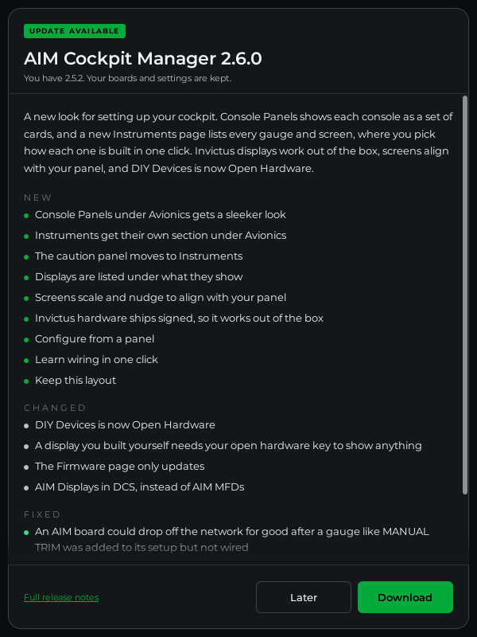

# Update the Manager

**What you'll do:** install a new version of AIM Cockpit Manager when one is available.

## How updates work

The manager checks for updates against the GitHub releases page for `invictuscockpits/aim-cockpit-manager-releases`. When a newer version is found, a banner appears at the top of the app window. The manager downloads the installer in the background; you run it when ready.

**Automatic checks** are on by default: the manager checks when it starts, every few hours while it runs, and when you open it from the system tray. If a new version comes out while the manager sits in the tray, a Windows notification says so; click it to open the manager. You can turn this off in **Settings → Check for updates automatically**.

---

## When an update is available

A banner appears at the top of the manager window:

> **AIM Cockpit Manager X.Y.Z is available. You are running A.B.C.**

Click **Download** in the banner. A window shows what's new in that version: a short summary, then what's **New**, what **Changed** and what was **Fixed**. The list scrolls when it is long. **Full release notes** opens the GitHub release page in your browser.

The window only ever opens when you click **Download**. It never pops up by itself, so it can't get in the way while you fly.

Click **Download** in the window to start. The window shows the download's progress, and so does the banner:

> **Downloading update X.Y.Z (45%)**

When the download completes, the window's button changes to **Install now** and the banner's to **Run installer**:

> **AIM Cockpit Manager X.Y.Z is ready to install.**

Click it. The manager checks that the installer is signed by Invictus Machine LLC, then starts it. Follow the prompts. The installer closes the manager automatically before replacing files. **Later** closes the window. The banner stays until you update.

> [!NOTE]
> The window arrived in 2.6.0. Updating from 2.5.2 or older, the banner's **View release notes** opens the release page in your browser instead.

---

## Check for updates manually

Click the version number at the bottom of the left sidebar. It shows **Checking for updates…**, then **up to date**, or the new version with the banner at the top of the window.

You can also go to **Settings** and click **CHECK NOW** under the Software section. If an update is found, it switches to **GET UPDATE** and the banner appears.

---

## See what changed

Click the small **i** next to the version at the bottom of the sidebar. The **About AIM Cockpit Manager** window shows what your version includes and the release notes for every version, with links to this guide and the issue tracker. **Copy details** copies your version information for a support message.

---

## If something's wrong

| Problem | Fix |
|---|---|
| No banner appears even though you expect an update | Click the version number at the bottom of the sidebar. If it still doesn't find one, confirm the release is published on the releases page. |
| "Download failed: the download stopped" or "doesn't match the release" | The download was cut off or damaged, so the manager threw it away. Click **Download** again. |
| "The downloaded installer isn't validly signed" | Click **Download** again. If it keeps happening, get the installer from the releases page. |
| "GitHub returned HTTP 403" error | The GitHub API rate limit was hit. Wait a few minutes and try again. |
| Network error | Check your internet connection. The manager needs access to `api.github.com`. |
| Installer fails to launch | The download may be incomplete. Try clicking Download again to re-fetch. |

---

**See also:** [Update Board Firmware](update-board-firmware.md)
