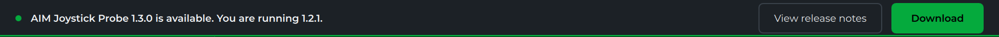

# Updates

AIM Joystick Probe checks for a newer version each time it launches. When one is
available, a banner appears across the top of the window:

> **AIM Joystick Probe X.Y.Z is available. You are running A.B.C.**

- **Download** downloads the installer inside the app. The banner shows the
  progress: **Downloading update X.Y.Z (45%)**.
- When the download finishes, the banner reads **AIM Joystick Probe X.Y.Z is
  ready to install** and the button changes to **Run installer**. Click it and
  follow the prompts. The installer closes the Probe before replacing files.
- **View release notes** opens the release page in your browser.

The banner stays until you update.

## Check for updates manually

Open **Settings** (the gear at the top right). Under **Software** you'll see your
version. Click **Check for updates**: it shows **up to date**, or the new
version with the banner at the top of the window.

If you're offline, already on the latest version, or there are no releases yet,
no banner appears. The check never interrupts you.

> [!NOTE]
> In-app downloads arrived in 1.3.0. Updating from 1.2.1 or older, the banner's
> **Download** opens the release page in your browser instead.
